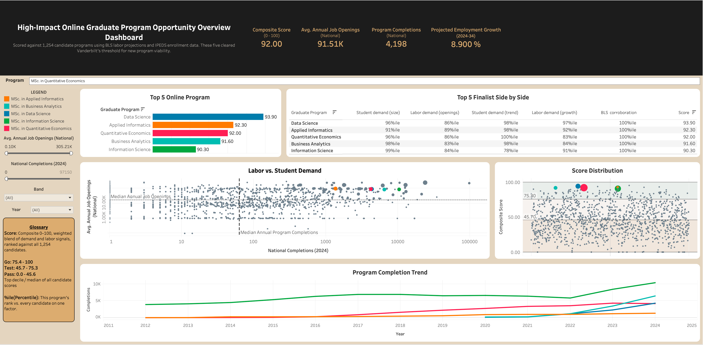
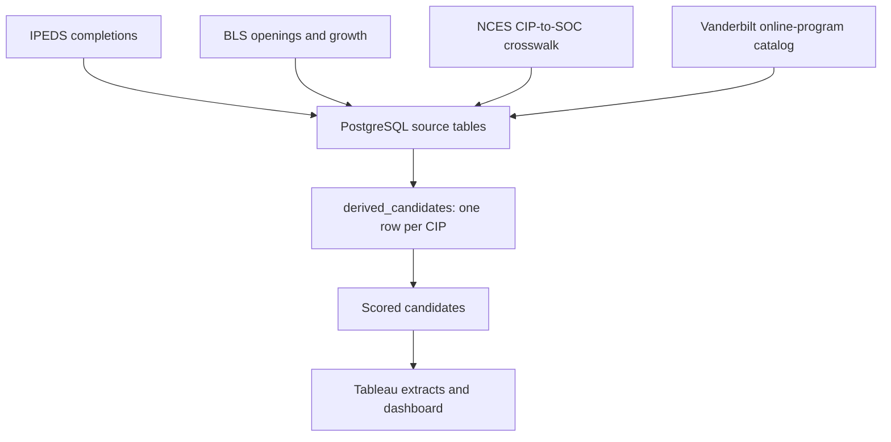
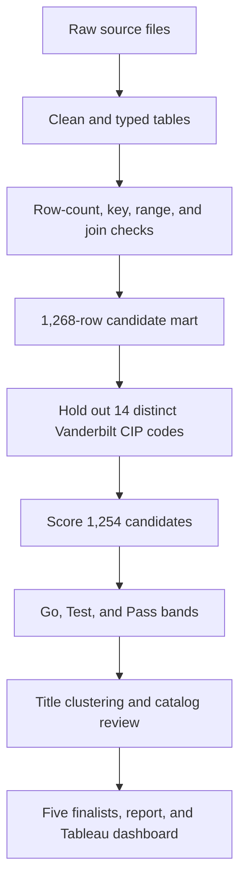
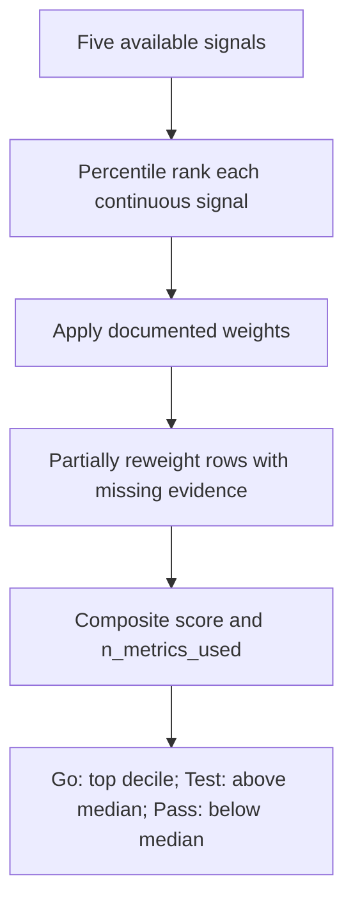

# Program Viability Assessment

Program Viability Assessment is an end-to-end data pipeline for one decision: which online graduate program should Vanderbilt launch next? I integrated IPEDS and BLS data through the NCES CIP-to-SOC crosswalk, modeled it in PostgreSQL, and applied a weighted scoring model. The pipeline starts with 1,268 graduate fields, holds out 14 distinct CIP codes already represented in Vanderbilt's online catalog, scores the remaining 1,254 candidates, and produces five finalists.

**[Open the Tableau dashboard](https://public.tableau.com/app/profile/pranish.p7454/viz/OnlineProgramViabilityAssessment/Program_Overview_Dashboard2)** or read the [feasibility report](deliverables/phase5-feasibility-report.pdf).

[](https://public.tableau.com/app/profile/pranish.p7454/viz/OnlineProgramViabilityAssessment/Program_Overview_Dashboard2)

## What this demonstrates

| Concept | How it is implemented | Where to look |
| --- | --- | --- |
| PostgreSQL relational modeling | Six source tables feed a one-row-per-CIP analysis mart; the CIP-to-SOC crosswalk is a many-to-many bridge with documented grain. | [`docs/erd.md`](docs/erd.md), [`docs/data-dictionary.md`](docs/data-dictionary.md), [`sql/01_create_tables.sql`](sql/01_create_tables.sql) |
| End-to-end data pipeline | Raw, clean, and derived layers are separate; typed loads and repeatable scripts move public IPEDS/BLS inputs through the PostgreSQL model. | [`scripts/`](scripts/), [`sql/02_load_data.sql`](sql/02_load_data.sql), [`sql/04_build_derived_candidates.sql`](sql/04_build_derived_candidates.sql) |
| Validation and methodology documentation | Row-count, key, year-range, and join-readiness checks sit beside the decisions log, data dictionary, ERD, and method notes. | [`sql/03_verification_checks.sql`](sql/03_verification_checks.sql), [`docs/decisions-log.md`](docs/decisions-log.md), [`docs/`](docs/) |
| Weighted scoring model | CTEs, window functions, `LEFT JOIN`s, employment-weighted aggregates, percentile ranks, and documented score bands build the shortlist. | [`sql/04_build_derived_candidates.sql`](sql/04_build_derived_candidates.sql), [`sql/06_score_candidates.sql`](sql/06_score_candidates.sql), [`sql/08_score_bands.sql`](sql/08_score_bands.sql) |
| Tableau decision dashboard | A five-signal score, title clustering, catalog review, and Tableau extracts turn a large candidate set into a bounded shortlist. | [`docs/decisions-log.md`](docs/decisions-log.md), [`sql/11_dashboard_extracts.sql`](sql/11_dashboard_extracts.sql), [`deliverables/dashboard/`](deliverables/dashboard/) |
| Reproducible analysis | The repository includes source files, derived exports, the dashboard workbook, and verification notebooks. | [`data/`](data/), [`deliverables/dashboard/`](deliverables/dashboard/), [`notebooks/`](notebooks/) |

## How the analysis works

### 1. Data architecture



The CIP academic-program codes and SOC occupation codes do not share a key. The crosswalk bridge has many-to-many relationships, so the mart retains each CIP's three highest-2024-employment matched occupations and calculates employment-weighted openings and growth. `LEFT JOIN`s retain fields with no labor-market match as missing evidence instead of silently dropping them.

### 2. Data flow from source to recommendation



### 3. Scoring method

| Signal | Weight | Why it is included |
| --- | ---: | --- |
| Current completions | 30% | A measure of the current student-demand base. |
| Employment-weighted job openings | 30% | A measure of current labor-market opportunity across matched occupations. |
| Completions trend | 15% | The direction of student demand, weighted below current size. |
| Employment-weighted job growth | 15% | The direction of labor demand, weighted below current size. |
| BLS top-30 flag | 10% | A corroborating, narrower signal rather than a primary driver. |



Percentile ranks prevent one extreme value from dominating the score. Partial reweighting keeps missing evidence visible through `n_metrics_used` instead of treating it as a zero. The top decile contains 126 candidates; title-word and four-digit CIP-prefix clustering reduces those to 61 distinct program ideas. After manual review excludes the Nursing cluster, 60 are ranked for shortlist review.

## Recommendation output

| Proposed program | CIP code | Score |
| --- | ---: | ---: |
| MSc. in Data Science | 30.7001 | 93.9 |
| MSc. in Applied Informatics | 11.0104 | 92.3 |
| MSc. in Quantitative Economics | 45.0603 | 92.0 |
| MSc. in Business Analytics | 30.7102 | 91.6 |
| MSc. in Information Science | 11.0401 | 90.3 |

These are proposed program names, not official degree titles. Catalog review caught a residential Data Science master's under a different CIP code than the algorithmic match; a code-only join would have missed that collision.

## Reproduce the pipeline

The repository includes the source files, clean tables, SQL stages, derived exports, and Tableau workbook. The SQL scripts document their expected `psql` order.

```bash
createdb program_viability
psql -d program_viability -f sql/01_create_tables.sql
psql -d program_viability -f sql/02_load_data.sql
psql -d program_viability -f sql/03_verification_checks.sql
psql -d program_viability -f sql/04_build_derived_candidates.sql
psql -d program_viability -f sql/05_export.sql
psql -d program_viability -f sql/06_score_candidates.sql
```

Continue through `sql/11_dashboard_extracts.sql` for score bands, shortlisting, and Tableau extracts. The scripts were developed against a local PostgreSQL instance; adjust the documented connection flags if needed.

## Repository map

| Path | Purpose |
| --- | --- |
| [`data/raw/`](data/raw/) | Collected source tables |
| [`data/clean/`](data/clean/) | Standardized, typed analysis inputs |
| [`data/derived/`](data/derived/) | Analysis mart, scores, shortlist, and Tableau extracts |
| [`sql/`](sql/) | DDL, loads, checks, mart construction, scoring, and exports |
| [`scripts/`](scripts/) | Collection, cleaning, parsing, and clustering scripts |
| [`deliverables/`](deliverables/) | Dashboard workbook, report, and presentation |
| [`docs/`](docs/) | Sources, ERD, data dictionary, decisions, and method notes |

## Interview notes: limits that shaped the method

- Inputs are national. Faculty capacity, pricing, regional demand, curriculum fit, and enrollment economics are outside this analysis.
- Median pay covers 60 of 832 occupations, so it is a corroborating flag rather than a scored metric.
- General and Operations Managers (SOC 11-1021) can inflate management-adjacent scores; affected candidates remain flagged for review.
- Missing and suppressed IPEDS observations lead to unequal trend windows and partial-evidence scores.

## Ownership

I framed the decision, designed the data model and scoring method, and reviewed material results before they entered the recommendation.

MIT License.
